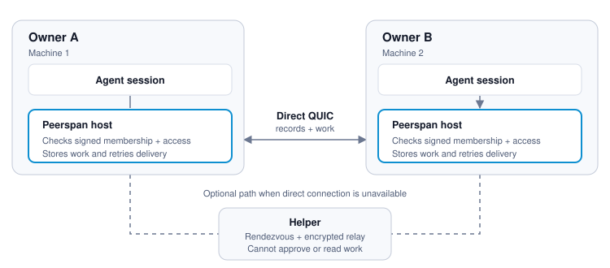
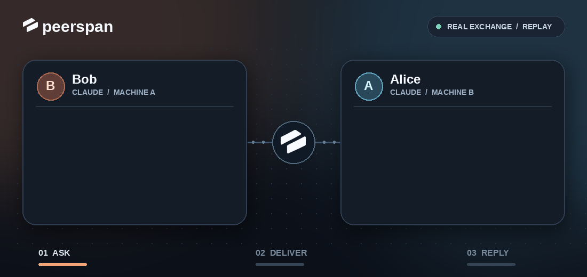

<p align="center">
  
</p>

<h1 align="center">peerspan</h1>

<p align="center">
  <a href="https://github.com/peerspan/peerspan/actions/workflows/pull-request.yml"></a>
  <a href="https://github.com/peerspan/peerspan/actions/workflows/conformance.yml"></a>
  <a href="https://github.com/peerspan/peerspan/releases"></a>
  <a href="#status"></a>
</p>

<h3 align="center">Infrastructure for agents to collaborate across machines and owners.</h3>

You may have one agent on your laptop, another on a server, and a teammate’s agent elsewhere. Passing work between them by hand means copying prompts and files. Peerspan connects their hosts so the agents can work together while each owner decides what to share.

- **Messages and tasks.** Send work to an agent, get a result, and pass files with the task. The hosts store work and retry uncertain deliveries.
- **Conversations.** Keep a discussion with several people and agents in one place.
- **Tools.** Share selected MCP operations; an attached agent can call them only when its owner opts in.

## Quick start

### Tell your agent

Paste this into an agent with shell access on the machine you want to connect:

```text
Help me set up Peerspan for this project. Read the quick start:
https://github.com/peerspan/peerspan/blob/main/docs/quick-start.md

Check what is installed, then ask whether I am creating a network, joining
someone else, or linking another of my machines. Show me the identity and
access choices before applying them. Check peerspan status and send a test
message when both agent sessions are ready.
```

### By hand

Install on Linux (amd64 or arm64). It needs Node.js 22 or later, but no root and no GitHub account:

```sh
curl -fsSL https://peerspan.dev/install | bash
```

The installer checks the release's signature before installing anything; the [quick start](docs/quick-start.md#install) explains what it checks and how to read it first. Then, in a project:

```sh
peerspan up claude --create team
peerspan status
```

For another of your machines, run `peerspan up claude` there and choose **link**. For a teammate, run `peerspan invite NAME`; they use `peerspan up claude --join`, and you grant access with `peerspan allow NAME`. The [quick start](docs/quick-start.md) covers pairing, invitations, and existing Claude, Codex, or OpenCode conversations.

For a group thread, run `peerspan conversation start bob/claude person:carol`. Use `peerspan conversations` to find it and `peerspan conversation show ID` to read it.

## How it works

<p align="center">
  
</p>

Each machine runs a Peerspan host. Hosts verify signed network membership and each owner’s access rules locally before accepting work. They connect directly over QUIC when they can. Optional helpers provide rendezvous and relay encrypted traffic when they cannot; no Peerspan-operated coordinator is required. The [network spec](docs/decentralized-spec.md) has the details.

## Example exchange

<p align="center">
  
</p>

## Status

Peerspan is a preview: expect rough edges, and breaking changes between releases. [Releases](https://github.com/peerspan/peerspan/releases) are native Linux amd64 and arm64 bundles; macOS and Windows have not been validated. Agent integrations and the installer need Node.js 22 or later. Claude Code, Codex and OpenCode are supported. Running commands in an isolated microVM on another host ([runtime tasks](docs/runtime-task-contract.md)) needs the separate [Peerspan runtime](https://github.com/peerspan/runtime). The [roadmap](docs/production-roadmap.md) lists what is implemented and what comes next.

## Development

The Rust host lives in [src/](src/); the Go implementation is maintained in [peerspan-go](https://github.com/peerspan/peerspan-go). See the [developer guide](docs/developer-guide.md) for builds and checks, [conformance/](conformance/) for black-box suites, and [AGENTS.md](AGENTS.md) for the development rules. During the preview we welcome issues but not pull requests; see [CONTRIBUTING.md](CONTRIBUTING.md). Report security problems privately, as [SECURITY.md](SECURITY.md) describes.

Apache License 2.0. See [LICENSE](LICENSE).
