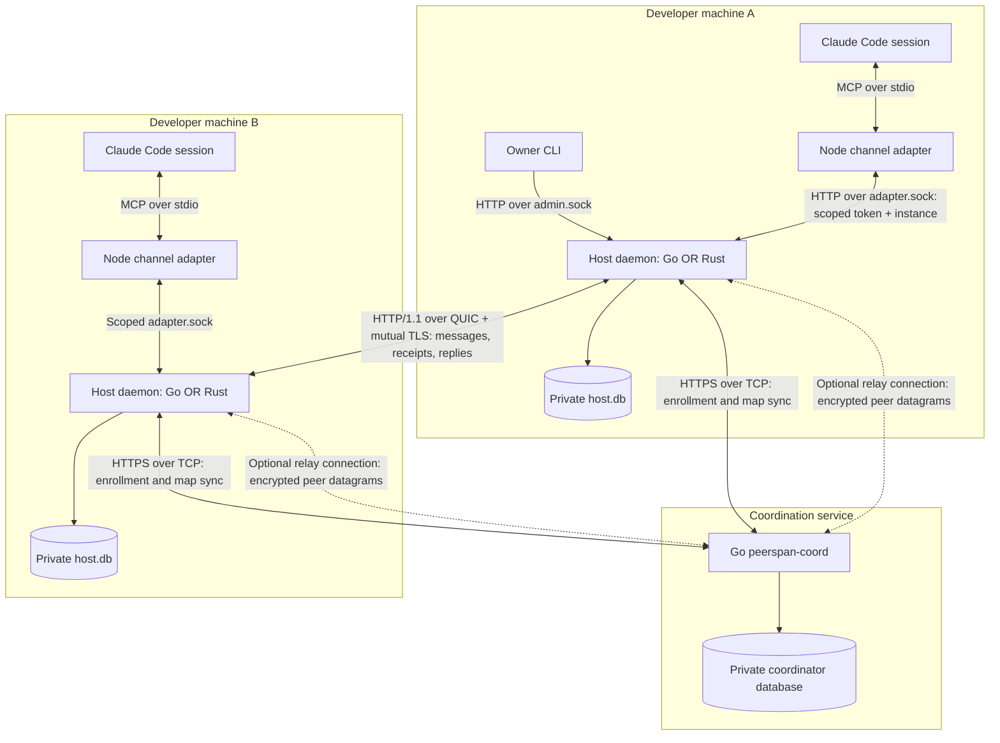
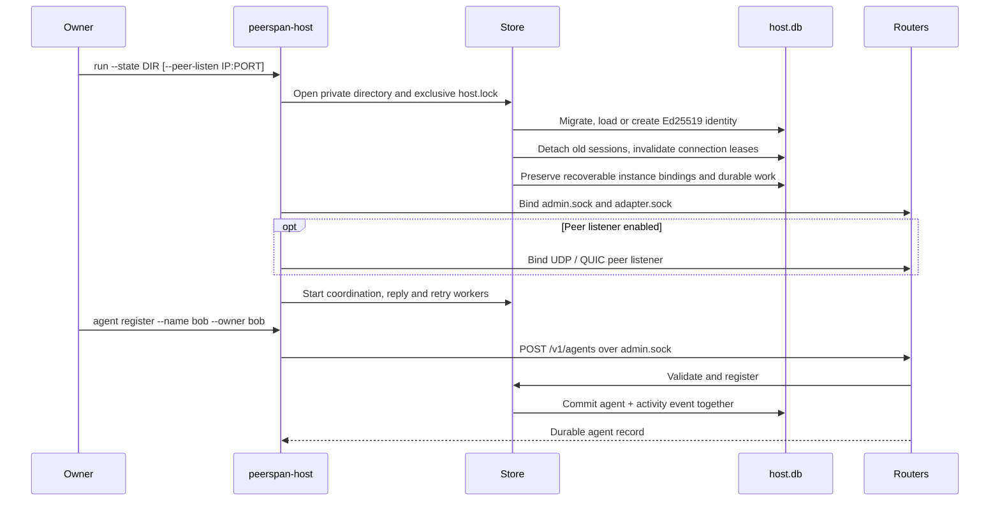
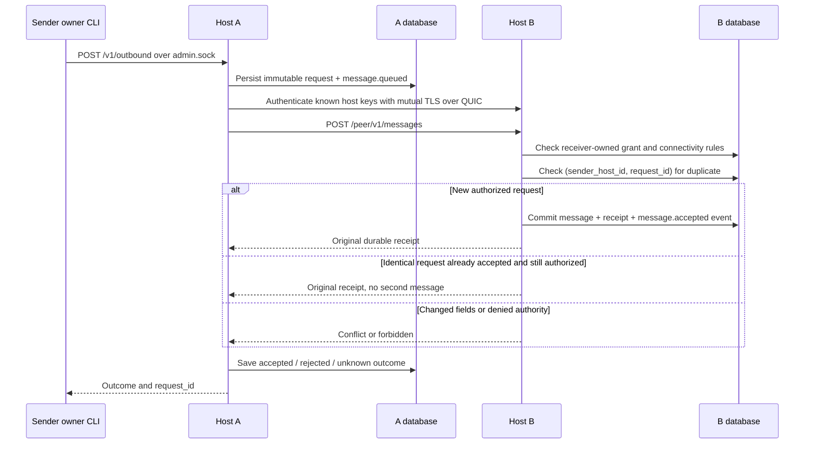
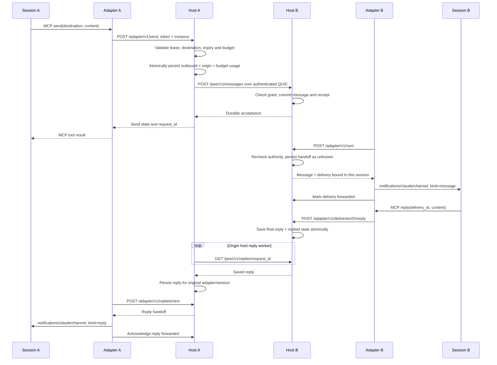
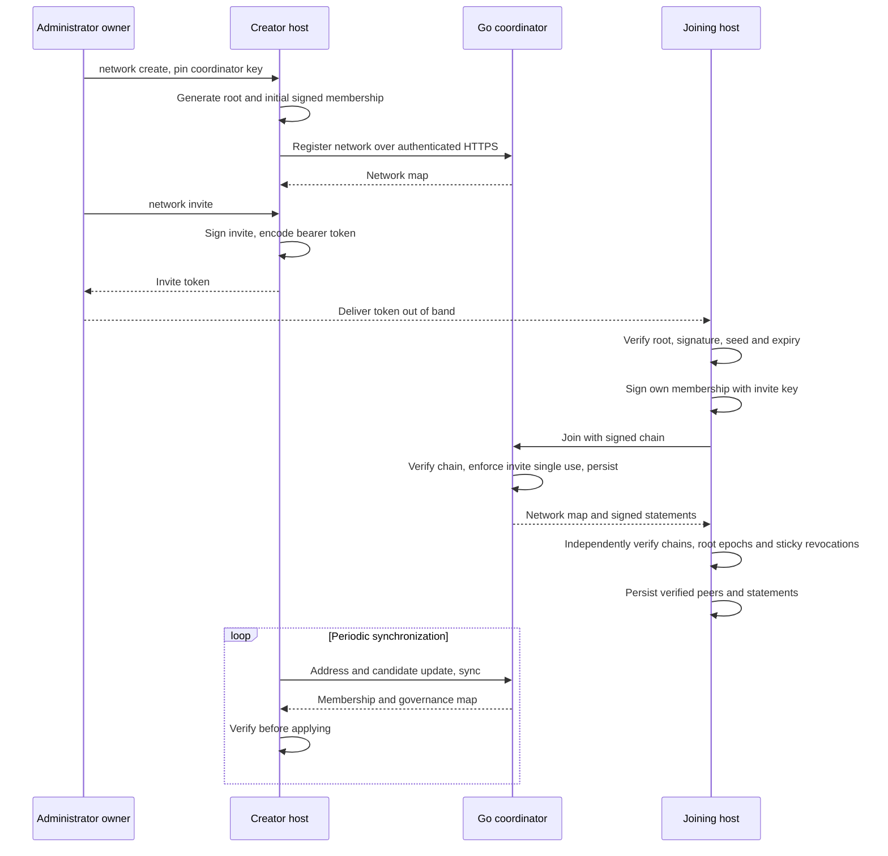
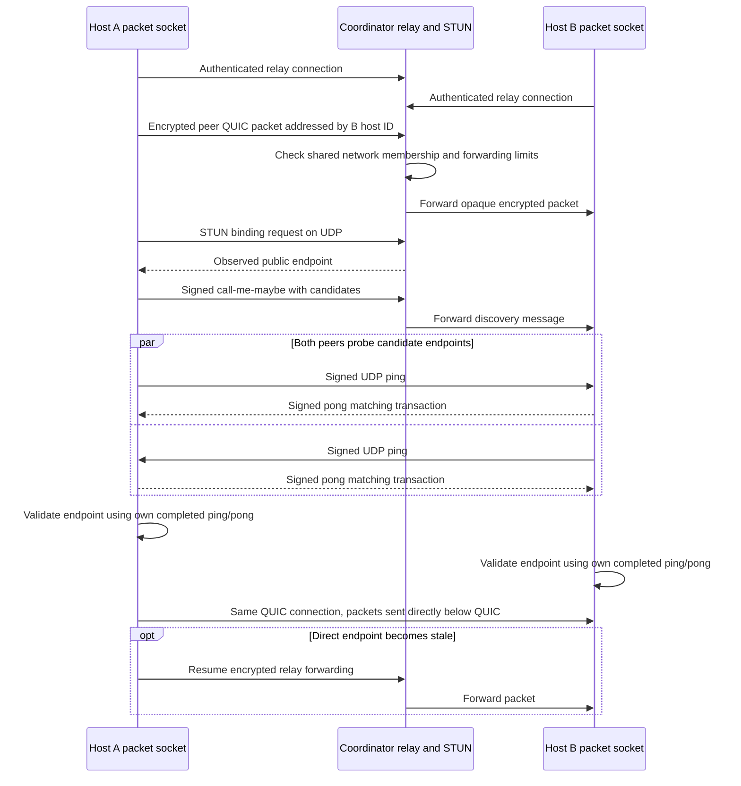
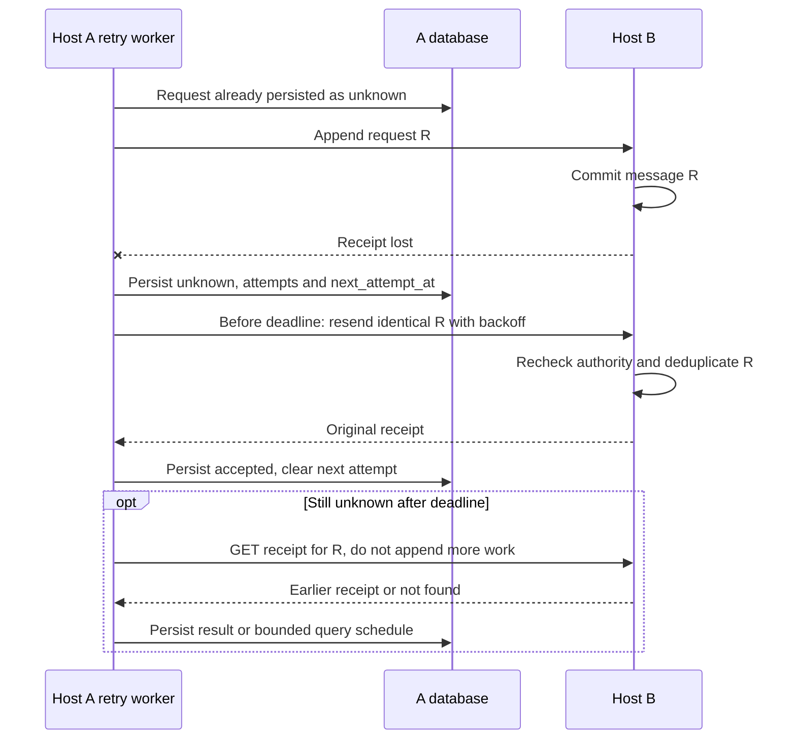
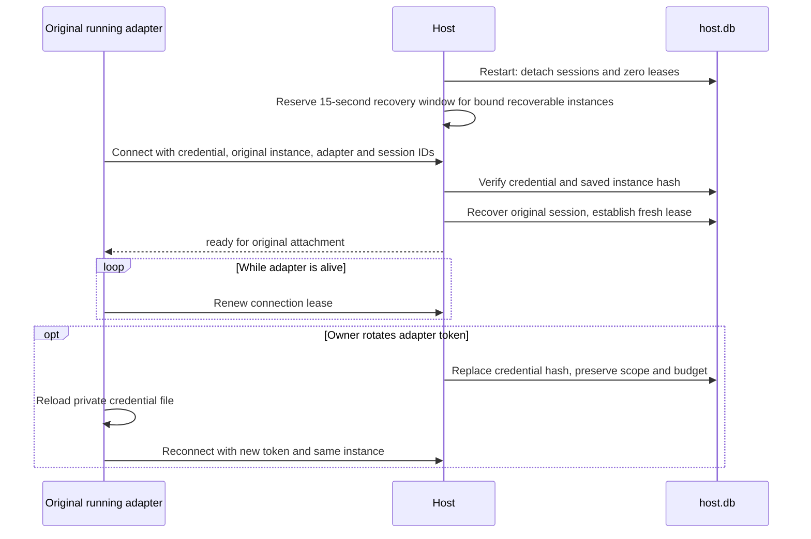
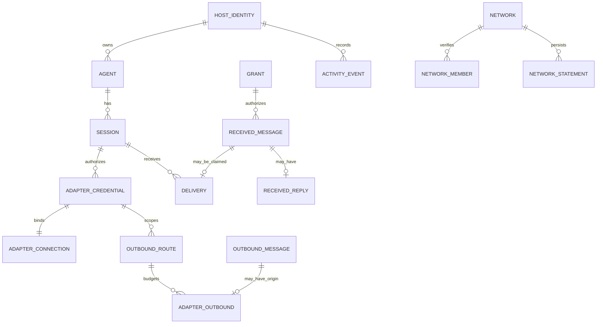

# Peerspan architecture and onboarding

Peerspan connects agents running on developer-owned machines. Each machine runs a host daemon that owns identity, local state, message authorization, and delivery into opted-in sessions. A separate coordinator distributes membership and reachability information. The first useful path through the code is a message from one live session to another, followed by its reply.

This map covers the primary checkout at `/root/peerspan/peerspan`, branch `admins-groups`, starting at commit `a6ee704`, including the uncommitted code present during inspection on October 6, 2026. Sibling `peerspan-*` directories are worktrees, not services. `mesh-new` holds broader design; `natbench` is a separate project. The diagrams describe logical responsibilities rather than independently deployed microservices.

## Start with these boundaries

- **Host identity** is a durable Ed25519 key. Mutual TLS authenticates hosts; a request does not yet carry a verified originating agent identity or delegation chain.
- **Agent identity** is a durable registry entry. A **session** is a temporary attachment to that agent. Registering or attaching an agent does not establish a ready integration.
- **Membership** makes a host a verified network peer. **Access** still requires a grant created by the receiving owner. Network administration does not grant access to agents.
- **Acceptance** means a message and activity event committed on the receiving host. **Forwarded** means the adapter sent a channel notification and recorded its acknowledgment. **Replied** means a final reply was saved. Neither acceptance nor notification acknowledgment proves model execution.

## Deployment and interfaces

Go and Rust implement the same host contract. They are alternatives on each machine, not a Go frontend calling a Rust backend. Both talk to the Go-only coordinator and the shared Node adapter. Their database migrations and externally visible behavior are intended to remain compatible; internal module layouts differ.



| Interface | Caller and transport | Authority and purpose |
| --- | --- | --- |
| `admin.sock`, `/v1/*` | Owner CLI; HTTP over private Unix socket | Local registry, grants, networks, adapter setup, inspection, owner sends. Socket mode 0600. |
| `adapter.sock`, `/adapter/v1/*` | Session adapter; HTTP over private Unix socket | Expiring bearer credential plus bound instance and live lease. Only scoped session operations and owner-defined destinations. |
| `/peer/v1/*` | Known host; HTTP/1.1 on individual bidirectional QUIC streams | Host key authentication plus receiver grant checks. Append message, fetch receipt, fetch reply. This is a separate router. |
| `/coord/v1/*` | Host daemon; HTTPS over TCP with pinned coordinator key and client host certificate | Enrollment, verified maps, governance and person statements. Hosts independently verify what comes back. |
| Relay and STUN | Host packet transport | Relay uses a separate TLS ALPN on the coordinator's TCP listener. STUN uses UDP on the same numeric coordinator port. Neither authorizes agent work. |

The coordinator is outside the **plaintext collaboration path**, but can be in the **packet forwarding path**. The inner peer QUIC connection remains encrypted end to end when carried by relay frames. Losing coordination can still affect membership freshness, connected-only grants, and relay reachability.

Sources: [Go startup](../go/cmd/peerspan-host/main.go), [Rust startup](../rust/src/main.rs), [Go socket lifecycle](../go/internal/host/daemon.go), [Go coordinator dispatch](../go/internal/coord/relay.go), [coordination contract](coordination-contract.md).

## Find the responsibility in either implementation

| Responsibility | Go entry points | Rust entry points |
| --- | --- | --- |
| CLI and daemon orchestration | [`cmd/peerspan-host/main.go`](../go/cmd/peerspan-host/main.go) | [`main.rs`](../rust/src/main.rs), [`cli.rs`](../rust/src/cli.rs) |
| Local admin router | [`host/api.go`](../go/internal/host/api.go) | [`api.rs`](../rust/src/api.rs) |
| Persistence, identity, migrations, registry | [`host/store.go`](../go/internal/host/store.go), [`session.go`](../go/internal/host/session.go) | [`store.rs`](../rust/src/store.rs), [`model.rs`](../rust/src/model.rs) |
| Peer authorization, grants, receipts | [`host/peer_store.go`](../go/internal/host/peer_store.go), [`peer_transport.go`](../go/internal/host/peer_transport.go) | [`peer_store.rs`](../rust/src/peer_store.rs), [`peer.rs`](../rust/src/peer.rs) |
| QUIC connections and HTTP streams | [`host/peer_quic.go`](../go/internal/host/peer_quic.go) | [`quic.rs`](../rust/src/quic.rs) |
| Relay packet socket and direct paths | [`host/peer_relay.go`](../go/internal/host/peer_relay.go), [`peer_path.go`](../go/internal/host/peer_path.go), [`disco`](../go/internal/disco/disco.go), [`stun`](../go/internal/stun/stun.go) | [`relay.rs`](../rust/src/relay.rs), [`disco.rs`](../rust/src/disco.rs), [`quic.rs`](../rust/src/quic.rs) |
| Network client and verified maps | [`host/network.go`](../go/internal/host/network.go), [`network_governance.go`](../go/internal/host/network_governance.go), [`network_persons.go`](../go/internal/host/network_persons.go) | [`network.rs`](../rust/src/network.rs) |
| Signed statements and person keys | [`membership`](../go/internal/membership/membership.go), [`person`](../go/internal/person/person.go) | [`membership.rs`](../rust/src/membership.rs), [`persons.rs`](../rust/src/persons.rs) |
| Adapter scope, handoff, replies, recovery | [`host/adapter_api.go`](../go/internal/host/adapter_api.go), [`adapter_store.go`](../go/internal/host/adapter_store.go), [`adapter_connection.go`](../go/internal/host/adapter_connection.go), [`adapter_outbound.go`](../go/internal/host/adapter_outbound.go) | [`adapter.rs`](../rust/src/adapter.rs), [`adapter_connection.rs`](../rust/src/adapter_connection.rs), [`adapter_outbound.rs`](../rust/src/adapter_outbound.rs) |
| Durable outbound retry | [`host/outbound_retry.go`](../go/internal/host/outbound_retry.go) | [`retry.rs`](../rust/src/retry.rs) |
| Harness discovery, setup, launch, diagnostics | [`internal/integration`](../go/internal/integration/provider.go), [`session_setup.go`](../go/cmd/peerspan-host/session_setup.go) | [`integration.rs`](../rust/src/integration.rs), [`adapter_setup.rs`](../rust/src/adapter_setup.rs) |
| Coordination server | [`cmd/peerspan-coord`](../go/cmd/peerspan-coord/main.go), [`internal/coord`](../go/internal/coord/coord.go) | Uses the Go coordinator; no Rust coordinator binary |
| Live session bridge | [`channel.mjs`](../integrations/claude-channel/channel.mjs), [`provider.mjs`](../integrations/claude-channel/provider.mjs) | Same Node integration |

`Store` is the central host state owner, and many domain operations are methods on it. In Go, most host files share the `host` package. In Rust, modules extend `Store`; blocking workers keep SQLite operations off the async executor. These files are responsibility boundaries within one daemon, not separate services.

## Sequence 1 Local startup and administration



The default state location is `$XDG_STATE_HOME/peerspan/host` or `$HOME/.local/state/peerspan/host`. Each running daemon needs its own directory. Host state uses SQLite schema versions 1 through 7 in the inspected code, including peer, network, adapter, outbound-route, connection, and signed-statement migrations. The database stores the private host key, so filesystem boundaries are part of the architecture. Go uses one database connection and full synchronous writes; Rust wraps its connection with a mutex.

## Sequence 2 Owner sends a durable peer message



A grant binds requester host, target agent, `message.append`, expiration, byte bound, and disconnected permission. It is checked before deduplication even on a resend. One direction's grant creates no reverse grant. Receipt lookup is a distinct read operation and can confirm earlier acceptance after grant expiration or revocation, while the sender remains a known host.

Read `PrepareOutbound`, `Exchange`, `AcceptMessage`, `grantBounds`, and `grantConnected` in [peer_store.go](../go/internal/host/peer_store.go) and [peer_transport.go](../go/internal/host/peer_transport.go); compare [peer_store.rs](../rust/src/peer_store.rs) and [peer.rs](../rust/src/peer.rs).

## Sequence 3 Live agent send and automatic reply



The receiver's grant and sender's outbound destination are different controls. The sender's owner chooses a named destination with a byte bound, expiry, and lifetime message budget; the receiver's owner grants incoming access. `PrepareAdapterSend` records the immutable request and its origin in one transaction. Reusing the same request does not consume another budget unit. Its deadline is at most five minutes from preparation and no later than route expiration.

The adapter exposes four MCP tools: `list_destinations`, `send`, `send_status`, and `reply`. Replies to initiated sends arrive asynchronously as `kind=reply` events correlated by request ID. They must not trigger another `reply` call. Owner CLI sends use explicit reply lookup instead of the automatic originating-session path.

Handoff deliberately records `unknown` **before** sending content to the session. A crash between claiming and acknowledgment cannot safely reveal whether the session received it. Unknown handoffs remain inspectable and are not automatically redelivered. Peer append retries and session handoff recovery therefore have different semantics. A reply to already delivered content can survive a lapsed coordination freshness check, but final grant bounds still apply.

Sources: [adapter outbound](../go/internal/host/adapter_outbound.go), [adapter handoff](../go/internal/host/adapter_store.go), [adapter API](../go/internal/host/adapter_api.go), [Node channel](../integrations/claude-channel/channel.mjs), [adapter contract](agent-adapter-contract.md).

## Sequence 4 Signed enrollment and map verification



This sequence shows the host-only invite chain. Default create/join flows can also admit an SSH Ed25519 **person** and bind the host to that person. The CLI obtains person signatures through `ssh-agent` or an explicit key; the daemon receives signed statements. The newer member-invite flow carries the person and host admissions together. Public-key admission with a descriptor is another enrollment path.

By default sync runs every 30 seconds. A connected-only grant requires membership in a network the receiving host synced within three configured intervals. Verified state survives coordinator outages, but this freshness rule can pause new work. Signed revocations remain sticky even if later maps omit them. Manual peers remain an independent owner configuration.

Sources: [network client](../go/internal/host/network.go), [governance enforcement](../go/internal/host/network_governance.go), [one-command flows](../go/internal/host/network_onecommand.go), [coordinator](../go/internal/coord/coord.go), [Rust network client](../rust/src/network.rs).

## Sequence 5 Relay fallback and direct path discovery



The combined packet socket maps a synthetic peer address to either the relay or a validated endpoint. QUIC keeps its logical peer address; packet routing changes below it. The discovery signature, freshness, replay checks, and matching pong validate a route, not a permission. Some NAT pairs and UDP-blocked networks stay on relay. Inspect `peer path HOST` before assuming a direct connection.

Sources: [Go packet socket](../go/internal/host/peer_relay.go), [Go discovery](../go/internal/host/peer_path.go), [Rust discovery](../rust/src/disco.rs), [relay server](../go/internal/coord/relay.go).

## Sequence 6 Lost receipt and durable retry



The daemon retries owner and adapter sends. Before the deadline it resubmits the same immutable request. After the deadline it only queries receipts; the inspected implementation bounds recovery to ten post-deadline receipt queries or 24 hours past the deadline. Exhausted recovery can leave the state `unknown` with no next attempt. It does not manufacture a rejection. Backoff is jittered, capped at 60 seconds, with four workers and a ten-second startup spread. Per-request locking prevents automatic and explicit attempts from racing.

Sources: [Go retry scheduler](../go/internal/host/outbound_retry.go), [Rust retry scheduler](../rust/src/retry.rs), [send retry conformance](../conformance/send_retry.py).

## Sequence 7 Adapter recovery after daemon restart



The live lease is 15 seconds; the Node adapter normally renews after five seconds. A new adapter cannot claim a live attachment. After the lease and startup grace expire, the owner can create a replacement authorization. Old work stays bound to its original session; it is not reassigned to the replacement. Token rotation preserves routes and usage. Unknown content handoffs remain unknown.

Sources: [connection state](../go/internal/host/adapter_connection.go), [replacement authorization](../go/internal/host/adapter_store.go), [recovery extension](adapter-recovery-contract.md).

## Durable data model

The following is a logical model. Several records are stored as JSON, so not every relationship shown is a SQL foreign key.



`received_messages` is keyed by sender and request ID. `outbound_messages` is keyed by peer and request ID. `deliveries` is unique per received message and binds the session and adapter that claimed it. `adapter_outbound` preserves the initiating adapter, session, and route so automatic replies go back to the correct origin. `network_statements` holds verified governance evidence. Activity sequence, message sequence, and delivery IDs serve different purposes.

## What is implemented and what is changing

| Slice | Status in this checkout | Evidence |
| --- | --- | --- |
| Local persistence and private admin API | Implemented | Store, router, lifecycle and host conformance |
| Known-host grants, QUIC, durable receipts | Implemented | Peer stores, transport and peer conformance |
| Signed enrollment, sticky revocation, leave and root rotation | Implemented | Host network governance and coordinator governance |
| Person admission and host binding | Implemented | Person modules and one-command enrollment |
| Relay, STUN and signed direct-path discovery | Implemented | Relay/path modules and NAT conformance |
| Automatic unknown-send retries | Implemented | Both retry schedulers; send retry conformance |
| Claude session sends, delivery, automatic replies, leases and recovery | Implemented | Shared channel and adapter modules |
| Delegated administrators and groups | In-progress uncommitted work; cross-language parity unverified | New Go membership/coordinator files and Rust `admins.rs`; modified verification paths. CLI wiring is being added while this checkout is under active development. |
| Owner policy distributed centrally, grants to groups, verified originating agent/delegation chain | Future design | Access model and production roadmap |
| Full tasks, peer conversations, remote tools/resources and isolated execution | Future collaboration/runtime work | Repository README and broader design |

Some existing overview sections describe revocation and retries as future work, refer to the former TCP peer transport, or say sessions cannot be launched. Read the implementation and the relevant contract extensions together: peer transport is QUIC; revocation and retries have code; an owner CLI can launch a supporting harness integration, while a peer message does not grant process execution. Administrator/group specifications are ahead of their end-to-end implementation in this snapshot.

## A practical first reading session

1. Read the boundary definitions above and [`host-service-contract.md`](host-service-contract.md). Identify the three host routers before inspecting handlers.
2. Trace Go `run` or Rust `run_daemon` from store opening to worker startup. Identify which state is durable and which state is invalidated on restart.
3. Follow an owner send through preparation, transport, `AcceptMessage`, and outcome persistence. Inspect authorization before deduplication.
4. Follow `PrepareAdapterSend`, `NextDelivery`, and the Node polling loop. Explain why a message can be accepted but never forwarded, and why unknown handoffs are not redelivered.
5. Follow network sync into map verification, then find where sticky revocations exclude peers. Keep membership separate from grants.
6. Read one conformance scenario matching the path you traced. These tests execute real binaries and cover cross-language interoperability, not just same-language unit behavior.

## Build and inspect a local host

Run from the repository root. Use a disposable private state directory for experimentation; do not reuse an existing host identity for a second daemon.

```bash
go -C go build -o /tmp/peerspan-onboarding-go ./cmd/peerspan-host
go -C go build -o /tmp/peerspan-onboarding-coord ./cmd/peerspan-coord
go -C go build -o /tmp/peerspan-onboarding-probe ./cmd/peerspan-peer-probe
cargo build --locked --manifest-path rust/Cargo.toml

# Terminal 1: foreground daemon
/tmp/peerspan-onboarding-go --state /tmp/peerspan-onboarding-state run

# Terminal 2: owner-local inspection
/tmp/peerspan-onboarding-go --state /tmp/peerspan-onboarding-state info
/tmp/peerspan-onboarding-go --state /tmp/peerspan-onboarding-state agent register --name learner --owner learner
/tmp/peerspan-onboarding-go --state /tmp/peerspan-onboarding-state agent list
/tmp/peerspan-onboarding-go --state /tmp/peerspan-onboarding-state activity
```

These are suggested onboarding commands, not a claim that the current uncommitted administrator/group work builds or passes conformance. For a two-host experiment, follow the [root README](../README.md) and [Claude setup guide](../integrations/claude-channel/README.md), with distinct state directories, receiver grants, and explicit peer listeners.

## Match changes to verification

| Change area | Shared suites to read and run |
| --- | --- |
| Registry, persistence, local interface | `host_service.py` |
| Peer authorization or transport | `peer_messaging.py`, `relay.py`, `nat_lab.py` |
| Enrollment, governance or persons | `coordination.py`, `revocation.py`, `persons.py`, plus relay/NAT coverage |
| Outbound sends or retries | `send_retry.py` |
| Adapter scope, handoff or recovery | `agent_adapter.py`, `adapter_outbound.py`, `adapter_recovery.py` |
| Integration setup or diagnostics | `claude_setup.py`, `harness_setup.py` |

Build both hosts and the Go coordinator/probe as required. Cross-language suites exercise Go→Go, Go→Rust, Rust→Go, and Rust→Rust. NAT lab needs root and Linux networking tools; person flows need OpenSSH. Deterministic MCP fixtures and real model experiments establish different evidence. Run the language checks required by [AGENTS.md](../AGENTS.md) for implementation changes. This onboarding addition changes documentation only.

## Debug by the last completed boundary

| Symptom | First place to inspect |
| --- | --- |
| CLI cannot connect | State directory and `admin.sock`; daemon lock/lifecycle |
| Peer cannot authenticate | Pinned host key, verified member map, sticky revocations; `KnownHost` |
| Send remains unknown | `message inspect`, attempt schedule, `peer path`, receiver sync freshness |
| Send is rejected | Receiver grant, target agent, bytes, expiration/deadline; changed request ID fields |
| Accepted message never reaches session | Adapter connection ready state; delivery records; grant recheck during claim |
| No automatic reply | Original `adapter_outbound` record, receiver reply record, origin reply worker and reply handoff |
| Session cannot recover | Original instance secret, token, lease, recoverability, adapter/session IDs and replacement history |
| Membership seems to grant access | It does not; create a receiver-owned grant and a sender-owned destination separately |

## Keep this map current

Update the affected sequence and module row when a router, persistent record, or worker changes. Update the implementation-status table when administrator/group commands become available. Check the relevant conformance scenario and both languages before describing a new behavior as supported. Keep future design separate from current runtime behavior, and retain `legacy/` as historical context rather than treating its execution model as the new host foundation.
