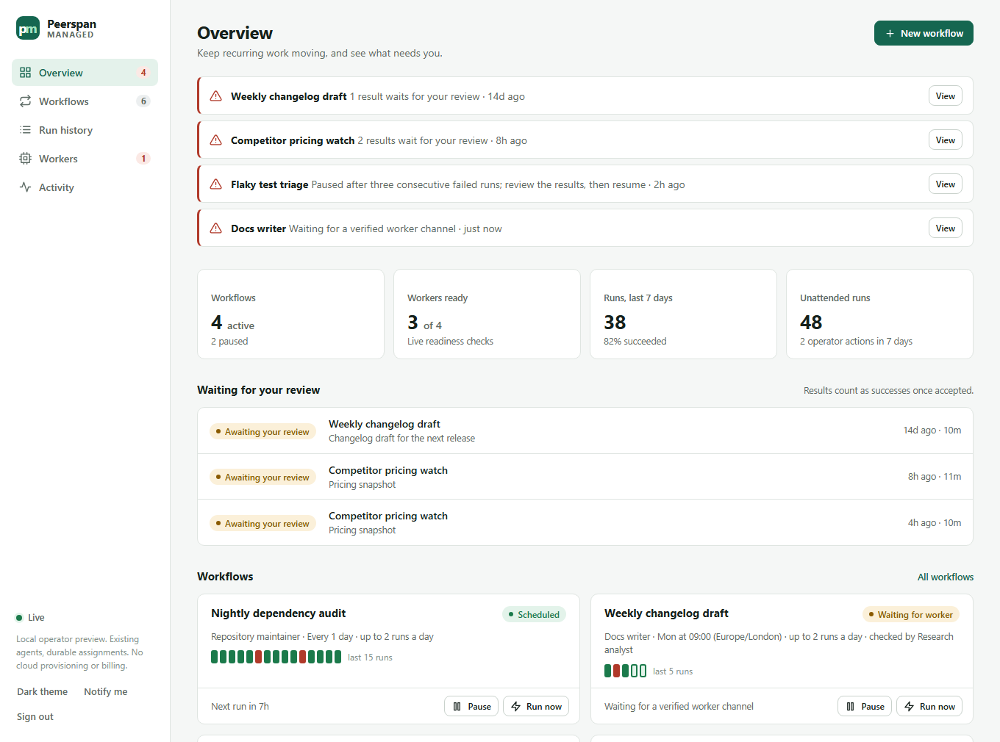

# Peerspan Managed operator preview

A local console and durable scheduler for agent sessions that are already
attached to Peerspan. It dispatches recurring assignments as Peerspan tasks,
keeps every task identity and result across restarts, and shows what needs you.
The Peerspan daemon and each owner's access rules stay the authority for
execution: this application only invokes the owner CLI on this machine.



The picture shows scripted demonstration data, not real agent work.

It needs Node 24, Linux or WSL, and an installed Peerspan CLI that accepts the
global `--json` flag. There are no npm dependencies and no build step.

## Start

```sh
node managed/cli.mjs doctor        # checks Node, flock, state permissions and the Peerspan CLI
node managed/cli.mjs serve
# In another terminal, print your private sign-in token:
node managed/cli.mjs token
```

Open http://localhost:4310 and paste the token. The server binds loopback only
and is not a hosted service. Runtime state lives in
`~/.local/state/peerspan-managed`, never in the repository; pass
`--state /absolute/dir` to every command for an independent workspace.

On Windows, `./managed.ps1 doctor`, `token` and `status` run the same commands
in WSL (Ubuntu-24.04 by default; `-Distro NAME -LinuxUser NAME` override that),
and `start` and `stop` control the user service described below.

## Connect a worker

A worker is one agent attached to Peerspan, with a running model session that
has acknowledged its Peerspan channel. Its host may run on this machine or on
another one. Prepare it with the upstream quick start and have its owner grant
the sender host task access to it. The scheduler never grants access and never
starts a model session.

### An agent whose host runs on this machine

```sh
node managed/cli.mjs connect --name "Repository maintainer" --agent maintainer
```

`--agent` is the agent's name as `peerspan agents` shows it, or its agent ID.
The registration pins the host and the agent; readiness then follows whichever
session of that agent is attached and verified, so re-attaching the agent needs
no change here. Options:

- `--host-state DIR`: the worker host's Peerspan state, when it is not the default.
- `--sender-state DIR`: the Peerspan state of the host that submits the tasks,
  when it is not the default. Sender and worker are two hosts.
- `--worker-state FILE` instead of `--agent`: the revision 1 form, a private JSON
  file naming `host_dir`, `host_id`, `agent_id`, `adapter_id` and `session_id`,
  for setups where a supervisor already maintains that file.

### An agent on another machine

```sh
node managed/cli.mjs connect --name "Research agent" --remote bob/researcher
```

`--remote` is the agent's address or agent ID as `peerspan agents` lists it for
the sender host. Nothing of the worker's machine is read: readiness comes from
the sender's directory, which says whether the agent is connected with a
verified channel, whether its host answered the sender's last refresh, and
whether its owner allows this sender to submit tasks. The controller refreshes
that directory when it starts and at most once a minute after that, and the
Workers page shows how old the evidence is. Add `--network ID` when the sender
host is in several networks, and `--sender-state DIR` as above. Only agents with addressable names (lowercase letters, digits, `.`, `_` and
`-`, which is what `peerspan attach` creates) appear in that directory.

This is weaker evidence than a local worker's own status: a session that has
just gone away can still look connected until the next refresh, and a task sent
in that window waits at the worker host until it is accepted or its acceptance
window passes.

### Shared rules

Use a dedicated agent. The scheduler never puts two of its own runs on one
agent, but it cannot reserve an agent against other dispatchers.

`disconnect --id ID` removes a worker once no workflow uses it. The Workers page
shows each worker's readiness with its reason, and what `peerspan status` says
needs attention, with the command Peerspan suggests: the worker host's for a
local worker, the sender host's for a remote one.

## Workflows

Create a workflow in the console: a bounded assignment, the worker, when it
runs, a daily dispatch limit and an acceptance window. New workflows are paused
unless you enable them.

- **Interval or schedule.** A workflow repeats after an interval, counted from
  the end of the previous run, or on chosen weekdays at local times in a time
  zone, such as weekdays at 09:00 Europe/London. Daylight-saving changes are
  handled: a skipped local time runs later by the change, a repeated one runs
  once. A slot that passes while a run is in progress, the workflow is paused or
  the controller is stopped runs once as soon as it can, not once per slot.
- **Results.** By default a succeeded run counts as the worker reports it. With
  "I check them", it waits for your verdict; with "An agent checks them", a
  reviewer agent checks it first (below). Accepted results count as successes,
  rejected ones as failures, and waiting ones as neither. Reviews never hold back
  the schedule, and a verdict is final.
- **Review criteria.** What a good result must do, such as "names every changed
  file and cites at least two sources". The reviewer agent receives them, and
  the console shows them to you when you review.
- **Rework.** A rejected result can be sent back to the worker once, twice or
  three times. The next run then starts at once with the instructions, the
  review and the previous result, and counts toward the daily limit like any
  run. Only the workflow's latest result is sent back: a later run has already
  done the work again.

- **Pause and resume.** Pausing stops new dispatch and lets the run in progress
  finish. Resuming does not run at once: the schedule decides, or "Run now".
- **Edit.** Changes apply from the next dispatch. A run that was already
  reserved keeps the exact instructions it was sent.
- **Archive and restore.** An archived workflow never dispatches and leaves the
  list; its runs stay in the history. There is no delete.
- **Failure circuit.** Three consecutive failed runs pause the workflow until
  you resume it.

Daily limits count dispatches per UTC day, including failed ones; they are not
cost limits, and model usage is billed by your provider.

### Reviewer agents

A reviewer is another connected worker, on this machine or another one, that is
not the workflow's own agent. When a run succeeds, the controller sends the
reviewer an ordinary Peerspan task with the assignment, your criteria and the
result, and asks it to begin its answer with `VERDICT: ACCEPT` or
`VERDICT: REJECT` followed by its reasons. The reasons become the result's
review note; after a rejection they are what the worker receives with a rework.

You are the fallback. When the review task fails, expires, is refused or
cancelled, or its answer does not start with a verdict line, the result waits
for your verdict instead, with the reason shown. You can also decide at any time
while the reviewer is still checking; its later answer is then kept on the run
page but changes nothing. The controller sends one review task per result and
never retries it on its own.

A review task holds the reviewer's agent like any run: it does one task at a
time across all workflows, results that finished first are checked first, and
reviews go ahead before new runs start. Reviews continue while a workflow is
paused or archived, because they concern work already done. A reviewer agent's
verdict is another agent's judgment; it is no more a guarantee than the
worker's own report.

## Runs

Every run has a page with the worker's reported result, the instructions that
were actually sent, and a timeline of the task's events, progress messages
included.

- **Cancel** asks the worker to stop. The run ends when the worker confirms, or
  with the worker's own result if it finishes anyway. A run that was never sent
  is cancelled without being sent. A cancellation does not count as a failure.
- **Release** is for a run that can no longer be resolved, for example because
  its worker host is gone. It frees the workflow and the worker here and stops
  all further calls for that task. It does not stop the worker.

A succeeded run is the worker's own report. Unless its workflow asks for review,
nothing in this preview checks the output; it never downloads artifacts or
approves anything on your behalf. Results waiting for your review are listed on
the overview, oldest first, and each run page has Accept and Reject with an
optional note. A reviewed run's page also shows the reviewer's verdict and
reasons, its full answer, what it was asked and its task's timeline, and links a
rejected run to its rework.

An agent run by upstream Peerspan's runtime (one microVM per task on a peerfs
fork) ends its result with a line such as `Branch: codex.task_… at commit 01…`.
The run page shows that branch beside the result; merge it with peerfs on the
worker's host. The controller reads nothing of peerfs itself.

## Recovery

- A task ID and its exact payload are stored before anything is sent. After a
  lost reply or a restart the controller inspects that same task first and
  resubmits the same ID and payload only when the sender daemon has never held
  it. It never invents replacement work.
- One unresolved run per workflow, and one unresolved task per worker agent,
  whether it is a run or a review task, enforced by the store. A review task is
  stored, sent and recovered exactly as a run's task is.
- A stopped controller exits within seconds; work it was waiting for is picked
  up again under the same identities at the next start.
- The Activity page records what you did and what the controller did. Each
  workflow shows how many runs it has finished since you last stepped in.

## Follow existing programs

```sh
node managed/cli.mjs observe --name "Existing research program" \
  --directory /absolute/private/controller/continuous
```

The directory must contain `config.json` and `state.json` in the documented
controller format. Observation is read only: it cannot pause, resume, dispatch
to or repair the external program, whose history stays with its own controller.
`unobserve --id ID` stops following it.

## Supervised operation

Create a user systemd service with absolute paths for your machine:

```ini
[Unit]
Description=Peerspan Managed local operator
After=network.target

[Service]
Type=simple
WorkingDirectory=/absolute/path/to/peerspan-managed
ExecStart=/absolute/path/to/node managed/cli.mjs serve --port 4310
Environment=PEERSPAN_BIN=/absolute/path/to/peerspan
Restart=on-failure
RestartSec=5
UMask=0077

[Install]
WantedBy=default.target
```

Enable it with `systemctl --user enable --now peerspan-managed.service`. Linux
needs a persistent user manager; Windows with WSL also needs the distribution
started after logon. A process lock refuses a second scheduler for the same
state directory. Nothing here replaces the Peerspan host service.

## Upgrading

The first command of this version that opens an existing state directory
migrates it in place, after saving a copy beside it as
`managed.vN-backup.sqlite`, N being the store version it found (1 to 3).
Connections, observations, workflows, runs, task IDs, results, verdicts and the
activity log keep their IDs and values; a run that was unresolved is reconciled
under its task ID as after any restart. Existing workflows keep their intervals,
schedules and review settings, have no reviewer agent, and never send results
back until you choose to. Restart the service after updating the checkout.

## Develop

```sh
npm --prefix managed run check                  # syntax check of every source
node managed/conformance/acceptance.mjs         # contract cases 1 to 6
node managed/conformance/operations.mjs         # contract cases 7 to 10
node managed/conformance/visibility.mjs         # contract cases 11 and 12
node managed/conformance/remote.mjs             # contract case 13
node managed/conformance/schedules.mjs          # contract cases 14 and 15
node managed/conformance/reviewers.mjs          # contract cases 16 to 18
# Actual two-host transport with scripted adapters, no model:
python3 managed/conformance/real-peerspan-smoke.py --bin /path/to/built/binaries
```

The suites are written from the [operator contract](../docs/managed-contract.md)
by a separate author who does not read this implementation; they use an
explicitly fake Peerspan executable and throwaway state. The code is small:
`lib/model.mjs` holds every state transition as one SQLite transaction,
`lib/engine.mjs` owns timing and all Peerspan calls, `lib/server.mjs` is the
HTTP boundary, and `public/` is the console.

The [product plan](../docs/managed-product.md) covers the path to managed
sessions, hosted workers and teams, and [managed-decisions.md](../docs/managed-decisions.md)
records the choices made so far. This is an unofficial Apache-2.0 fork, not an
upstream Peerspan hosted product.
